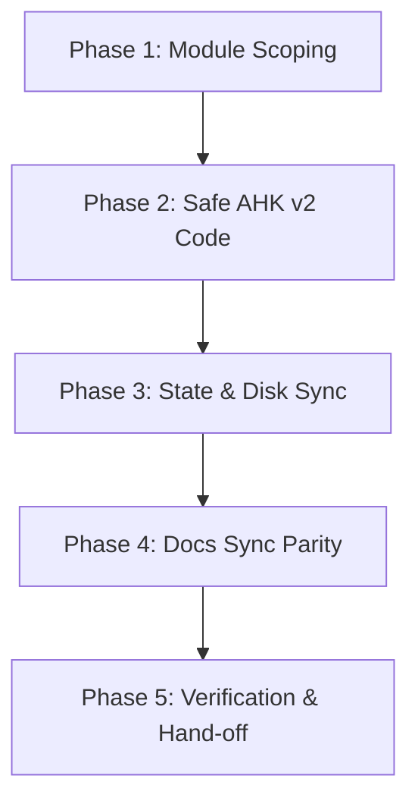

# AGENTS.md — Canonical AI Instructions & Development Rules for Minou

This document is the **root authority** for all AI coding assistants (such as Antigravity, GitHub Copilot, Cursor, and Gemini) operating within the Minou repository. All agents **must strictly adhere** to these principles, conventions, and operational workflows.

---

## 1. Project Overview & Philosophy

Minou is a modern, modular, dark-themed popup launcher and automation suite built with **AutoHotkey v2.0** for Windows 11. It blends keyboard-centric productivity (<kbd>F3</kbd>, <kbd>Shift</kbd> + <kbd>F3</kbd>) with mouse-friendly contextual controls.

### Guiding Principles
- **Instant Response**: Launch latency must remain under 16ms. State is cached in memory; never read files synchronously inside hotkey handlers.
- **Safety First**: Never execute unvalidated commands. Bypass WDAC policy restrictions gracefully via Windows Shell COM delegation.
- **Strict Modularity**: Maintain high cohesion and low coupling. Keep `Minou.ahk` minimal.
- **Zero Legacy Debt**: Exclusively target AutoHotkey v2.0+. No v1 fallback or hybrid syntax permitted.

---

## 2. AutoHotkey v2.0 Exclusive Code Standards

AutoHotkey v2 is a completely distinct, breaking language from v1. Under **no circumstances** should any v1 syntax, legacy commands, or hybrid code be written into this repository.

### Mandatory Directives
- Every script entry point must include:
  ```ahk
  #Requires AutoHotkey v2.0
  #SingleInstance Force
  Persistent
  ```

### Strict Syntax Rules & Prohibited v1 Constructs
1. **Expressions Everywhere**:
   - All assignments must use `:=`. The legacy `=` assignment is strictly prohibited.
   - All string literals **must** be enclosed in quotation marks (`"text"`). Barewords are identifiers or variables, never literal strings.
   - Function calls **must** use parentheses: `MsgBox("Message", "Title", "Icon!")`, `FileExist(path)`.
2. **Variable Dereferencing**:
   - **Never** use `%var%` in parameter lists or expressions. Variables are evaluated directly: `MyFunc(var1, var2)`.
   - Use the `&` reference operator for output variables: `MouseGetPos(&mouseX, &mouseY)`, `DllCall(..., "UInt*", &outLen)`.
3. **Data Structures**:
   - Key-value mappings **must** use `Map()`: `myMap := Map("key", "value")`, accessed via `myMap["key"]`.
   - Linear lists **must** use `Array()` or `[]`: `myArr := ["item1", "item2"]`, accessed with 1-based indexing `myArr[1]`.
   - Never use pseudo-arrays (`Item%Index%`).
4. **GUI & Event Binding**:
   - Use the modern object-oriented GUI API: `myGui := Gui("+AlwaysOnTop")`.
   - Register event listeners using `.OnEvent()`: `editBox.OnEvent("Change", (*) => OnChangeHandler())`.
   - Never write legacy `Gui, Add, ...`, `Gui, Show`, or `glabels`.
5. **File Operations**:
   - Use `FileRead(path, "UTF-8")` to read files.
   - Use `fileObj := FileOpen(path, "w", "UTF-8")` followed by `fileObj.Write(...)` and `fileObj.Close()` (or `FileAppend()`) to write files.
   - **Do not invent nonexistent functions** such as `FileWrite()`.
6. **Error Handling**:
   - Always catch exceptions explicitly:
     ```ahk
     try {
         ; fallible operation
     } catch Error as err {
         ; handle err.Message
     }
     ```
7. **Scope Discipline**:
   - In AHK v2, functions are assume-local. When accessing or mutating global maps/arrays declared at script level, explicitly declare `global VariableName`.

---

## 3. Architecture & Strict Modular Boundaries

```
Minou/
├── Minou.ahk                # Root Orchestrator & Lifecycle Bootstrapper ONLY
├── Modules/                 # Feature-specific implementations
│   ├── Launcher.ahk         # Custom dark GUI launcher & keyboard event handlers
│   ├── MenuBuilder.ahk      # Data unification & menu entry formatting
│   ├── Json.ahk             # Pure OOP JSON parser and serializer
│   ├── Search.ahk           # Search algorithms & filtering engine
│   ├── Icons.ahk            # Icon extraction & caching
│   ├── Settings.ahk         # Runtime settings & hotkey bindings
│   ├── Utilities.ahk        # Encoding, conversions & clipboard tools
│   ├── WindowManager.ahk    # DPI & multi-monitor cursor placement
│   ├── Snippets.ahk         # Dynamic token substitution engine
│   └── Prompts.ahk          # Prompt file loading & clipboard injection
├── Config/                  # Active configuration files (JSON)
├── Cache/                   # Persistent caches (icons.db, recent.json)
└── Docs/                    # Canonical documentation
```

### Modular Boundary Rules
- **Rule 3.1 (`Minou.ahk` Purity)**: `Minou.ahk` is strictly an orchestrator for lifecycle startup (`InitMinou`), global state declarations, and `#Include` directives. **Do not add new business logic, GUI controls, or utility algorithms directly to `Minou.ahk`.**
- **Rule 3.2 (Module Encapsulation)**: All new features must be implemented in their designated file under `Modules/`. If a module does not exist, create it in `Modules/` and `#Include` it within `Minou.ahk`.
- **Rule 3.3 (Inter-Module Communication)**: Modules communicate through clean function calls or normalized data structures (such as standard entry objects generated by `MenuBuilder.ahk`).

---

## 4. Configuration Protocol (`Config/*.json`)

1. **Root `config.json` is Deprecated**: The root `config.json` is legacy and must **not** be modified. All active configurations live exclusively in `Config/`:
   - `Config/settings.json` $\rightarrow$ Hotkeys, UI dimensions, theme preferences.
   - `Config/config.json` $\rightarrow$ Programs, directories, utilities.
   - `Config/urls.json` $\rightarrow$ Categorized bookmarks and dashboards.
   - `Config/snippets.json` $\rightarrow$ Text templates and dynamic snippets.
   - `Config/prompts.json` $\rightarrow$ Structured LLM prompts.
2. **Memory-Disk Synchronization**:
   - At startup, configs are loaded into global maps/arrays (`ConfigData`, `SettingsData`, `UrlData`, etc.).
   - Any runtime setting or item modification made by code must simultaneously update the active in-memory collection **and** serialize to disk via `SaveJsonFile()`.

---

## 5. Execution Safety & Process Isolation

- **Mandatory `SafeRun()` Usage**: Never call native `Run()` directly on external programs. Always dispatch via `SafeRun(target, args)` to ensure:
  1. Automated environment variable expansion via `ExpandEnvVars()`.
  2. WDAC / Application Control policy bypass via `ComObject("Shell.Application").ShellExecute()`.
  3. Graceful fallback without blocking dialogue crashes.
- **Dynamic Variable Tokens in Snippets**:
  - Always support `{DATE}`, `{TIME}`, `{CLIPBOARD}`, and `{ENTER}`.
  - Temporarily backup the user's clipboard, wait for readiness with `ClipWait(1)`, inject text with `Send("^v")`, and restore previous clipboard contents after an asynchronous delay.

---

## 6. Agent Change Implementation Protocol (ACIP)

When an AI agent is requested to add features, fix bugs, or modify settings in Minou, the agent **must execute the following five-phase workflow**:



### Phase 1: Pre-Change Discovery & Module Scoping
1. Determine which domain the change impacts. Identify or create the responsible module file under `Modules/` (e.g., `Modules/Search.ahk`, `Modules/Icons.ahk`, `Modules/Snippets.ahk`).
2. Verify existing helpers in [Docs/03-Api-And-Helpers.md](Docs/03-Api-And-Helpers.md) to avoid duplicating utility routines.
3. Keep `Minou.ahk` minimal: only add global state declarations or `#Include` directives to `Minou.ahk`.

### Phase 2: Safe AutoHotkey v2 Implementation
1. Ensure all code strictly obeys Section 2 (AutoHotkey v2 Exclusive Standards).
2. Never introduce v1 commands or non-existent methods (`FileWrite`).
3. Always wrap external system interactions (registry queries, file reads, process executions, DllCalls) in `try ... catch Error as err`.

### Phase 3: Dual State-Disk Synchronization
1. If the change mutates configuration or user preferences, update both:
   - In-memory collection: `ConfigData`, `SettingsData`, `UrlData`, etc.
   - Disk file: Call `SaveJsonFile(filePath, inMemoryObject)` to save to `Config/*.json`.
2. Do not write to root `config.json`.

### Phase 4: Mandatory Documentation Synchronization (Strict Parity Rule)
Code and documentation must never diverge. In the **same turn** that any code or configuration change is made, update the relevant canonical Markdown files:

| If you touch... | You MUST update... |
| :--- | :--- |
| JSON keys, schema, or configuration files | [Docs/02-Configuration.md](Docs/02-Configuration.md) |
| Functions, methods, classes, or API signatures | [Docs/03-Api-And-Helpers.md](Docs/03-Api-And-Helpers.md) |
| Architecture, lifecycle, GUI layout, or state flow | [Docs/01-Architecture.md](Docs/01-Architecture.md) |
| Completed features, new milestones, or backlog items | [Docs/04-Roadmap.md](Docs/04-Roadmap.md) & [Docs/05_ChangeLog.md](Docs/05_ChangeLog.md) |
| New files, restructured modules, or added docs | [Docs/06_DocumentationIndex.md](Docs/06_DocumentationIndex.md) & [ReadMe.md](ReadMe.md) |

### Phase 5: Verification & User Hand-off
1. **Automated Syntax Check**:
   Run the syntax validation command:
   ```powershell
   & "C:\Program Files\AutoHotkey\v2\AutoHotkey64.exe" /validate "Minou.ahk"
   ```
2. **Interactive Testing Prompt**:
   Inform the user how to test the change live (e.g. summon with <kbd>F3</kbd>, search mode with <kbd>Shift</kbd> + <kbd>F3</kbd>, or right-click system tray $\rightarrow$ *Reload*).
