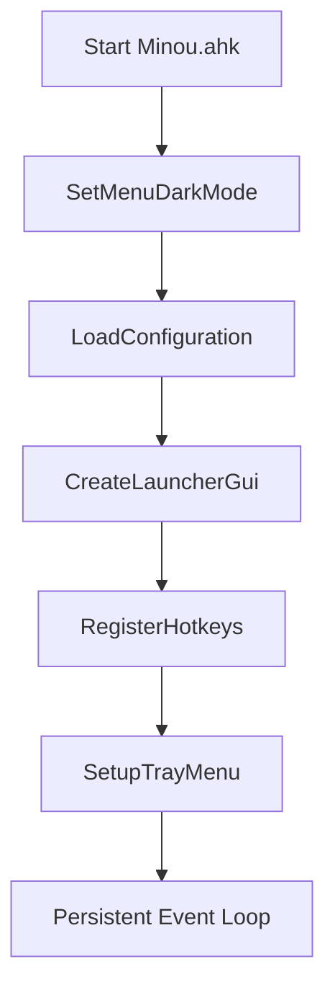

# Architecture

Minou is a modern, modular, dark-themed popup launcher and automation suite built for AutoHotkey v2.0 on Windows 11. It bridges keyboard-driven rapid command execution with mouse-friendly contextual menus.

---

## 1. Architectural Evolution

Minou's codebase reflects a transition from a monolithic script prototype to a modular system:

```
Legacy Prototype (Minou AHK)               Modular System (Minou.ahk)
┌───────────────────────────────┐          ┌───────────────────────────────┐
│ 789-line monolithic script    │          │ Minou.ahk (Root Orchestrator) │
│ - Built-in AHK Menu() popups  │   ───►   ├─ Modules/Json.ahk             │
│ - Embedded JSON parser        │          ├─ Modules/Launcher.ahk         │
│ - Mixed logic & data bindings │          ├─ Modules/MenuBuilder.ahk      │
│ - Single config.json          │          └─ Modules/* (Modular Stubs)    │
└───────────────────────────────┘          └─ Config/*.json (Split Schema) ┘
```

### Why Replace Native `Menu()` with a Custom GUI?
The initial implementation used AHK's native `Menu()` object styled via `uxtheme.dll`. The project transitioned to a custom GUI (`Modules/Launcher.ahk`) for several architectural advantages:
- **Real-Time Interactive Search**: Native menus cannot host an interactive search edit box at the top.
- **Consistent Fluent Dark Theme**: Native Win32 menus have OS rendering limitations and cannot achieve custom hex styling (`0x1A1A1A`, `0x232323`).
- **Smooth Layout & Categorization**: A two-pane layout (Category ListBox + Results ListView) provides instant navigation across hundreds of items.
- **Rich Metadata Display**: ListViews allow showing multiple columns (Name, Category, Type, Shortcut) without submenu clutter.
- **Keyboard & Mouse Parity**: Full navigation via `Up`/`Down`, `Enter`, `Esc`, as well as mouse clicks.

---

## 2. Directory Layout & Module Responsibilities

```
Minou/
├── Minou.ahk                       # Root entry point & lifecycle coordinator
├── Minou AHK                       # Legacy monolithic reference script
├── Instructions 2 Minou F3 PCPaths.md # Master architectural blueprint & feature spec
│
├── Config/                         # Modular JSON configuration files
│   ├── config.json                 # Core programs, folders, utilities
│   ├── settings.json               # Hotkeys and visual settings
│   ├── urls.json                   # Categorized web bookmarks and cyber tools
│   ├── snippets.json               # Dynamic text snippets & templates
│   ├── prompts.json                # LLM system prompts & templates
│   └── hotstrings.json             # Auto-expansion hotstrings definitions
│
├── Modules/                        # Modular subroutines
│   ├── Launcher.ahk                # Custom dark GUI launcher & keyboard event handlers
│   ├── MenuBuilder.ahk             # Aggregates data sources into unified entry records
│   ├── Json.ahk                    # OOP JSON parser and serializer (JsonParser, StringifyJson)
│   ├── Icons.ahk                   # (Planned) Local icon extraction & shell caching
│   ├── Search.ahk                  # (Planned) Fuzzy search engine across all item types
│   ├── Settings.ahk                # (Planned) Runtime configuration & hotkey manager
│   ├── Utilities.ahk               # (Planned) Encoding, formatting, and clipboard utilities
│   ├── WindowManager.ahk           # (Planned) Multi-monitor placement & window activation
│   ├── Snippets.ahk                # (Planned) Advanced template & token substitution engine
│   ├── Prompts.ahk                 # (Planned) Markdown prompt loader and clipboard injector
│   └── Hotstrings.ahk              # Text expansion manager and GUI editor
│
├── Cache/                          # Runtime persistent cache
│   ├── icons.db                    # Cached icon paths / binaries
│   └── recent.json                 # Usage tracking and recents history
│
├── Plugins/                        # Drop-in third-party extension modules
│
├── Assets/                         # Static resources
│   └── Icons/                      # Bundled SVG / PNG assets
│
└── Docs/                           # Canonical project documentation
```

---

## 3. Initialization Lifecycle (`InitMinou`)

When `Minou.ahk` launches, initialization follows a deterministic boot sequence:



1. **`SetMenuDarkMode()`**: Calls `uxtheme.dll` ordinals 135 (`SetPreferredAppMode` = 2 / ForceDark) and 136 (`FlushMenuThemes`) to enforce dark styling across any system menus or dialogues.
2. **`LoadConfiguration()`**: Ingests `Config/config.json`, `Config/settings.json`, `Config/urls.json`, `Config/snippets.json`, and `Config/prompts.json` into memory using `LoadJsonFile()`.
3. **`CreateLauncherGui()`**: Constructs the borderless, always-on-top Fluent GUI (`+AlwaysOnTop +ToolWindow -Caption`), sets up background colors (`0x1A1A1A`), binds event listeners, and keeps the window hidden until summoned.
4. **`RegisterHotkeys()`**: Reads user hotkeys from `SettingsData` (defaults: `F3` for normal launch, `Shift+F3` for direct search focus) and binds them using AHK v2 `Hotkey()`.
5. **`SetupTrayMenu()`**: Replaces the default tray menu with options to show launcher, edit configs, reload, and exit.

---

## 4. Global State & Data Pipeline

To achieve instant popup response times (< 16ms), Minou holds all parsed data in memory:

| Variable | Type | Source | Purpose |
| :--- | :--- | :--- | :--- |
| `ConfigData` | `Map` | `Config/config.json` | Stores core arrays (`programs`, `folders`, `utilities`) |
| `SettingsData` | `Map` | `Config/settings.json` | Runtime user settings (`hotkey`, `searchHotkey`, `theme`) |
| `UrlData` | `Map` | `Config/urls.json` | Key-value mapping of category names to URL entry arrays |
| `SnippetData` | `Map` | `Config/snippets.json` | Categorized text snippet definitions |
| `PromptData` | `Array` | `Config/prompts.json` | List of LLM prompt objects |
| `HotstringData` | `Array` | `Config/hotstrings.json` | Auto-expansion triggers and replacements |
| `CurrentEntries` | `Array` | Dynamically Built | Flattened, standardized records produced by `BuildMenuEntries()` |
| `AllSearchItems` | `Array` | Cached Database | Complete searchable item catalogue |

### Unified Item Structure
Every launchable item across all sources is normalized by `BuildMenuEntries()` into a uniform object:
```ahk
{
    name: "Entry Display Name",
    category: "Category Name",
    kind: "url" | "program" | "folder" | "snippet" | "prompt" | "utility" | "setting" | "script",
    target: "Path / URL / Text Payload / Command",
    hwnd: 0x12345 ; Optional, for running scripts
}
```

---

## 5. GUI & Window Positioning

When summoned (`ShowLauncherGui`):
1. **Cursor Context**: The mouse position is sampled with `CoordMode "Mouse", "Screen"` and `MouseGetPos(&mouseX, &mouseY)`.
2. **Offset & Bounding Checks**: The GUI calculates an offset of `+20px, +20px` to avoid covering the cursor.
3. **Multi-Monitor Screen Clamping**:
   - `xPos + 600 > A_ScreenWidth` $\rightarrow$ clamps `xPos := A_ScreenWidth - 620`
   - `yPos + 400 > A_ScreenHeight` $\rightarrow$ clamps `yPos := A_ScreenHeight - 420`
4. **Focus Handling**: If invoked via `Shift+F3`, the search box is cleared and focused immediately; otherwise, existing search results are refreshed.

---

## 6. Execution & Security Isolation (`SafeRun`)

Launching programs on modern Windows systems often encounters WDAC (Windows Defender Application Control) or AppLocker blocks when executed via standard AutoHotkey `Run()`. 

Minou solves this in `SafeRun`:
1. **Environment Variable Expansion**: Passes the target string through `ExpandEnvVars()`.
2. **Primary Shell Execution**: Uses Windows Shell COM object:
   ```ahk
   ComObject("Shell.Application").ShellExecute(expandedTarget, strArgs, "", "open", 1)
   ```
   This delegates process creation directly to `explorer.exe`, bypassing AHK's `RunWithHandles` WDAC block.
3. **Fallback Handling**: If COM execution fails, falls back to native `Run()`, and displays a non-blocking tooltip if the file does not exist or execution is denied.
