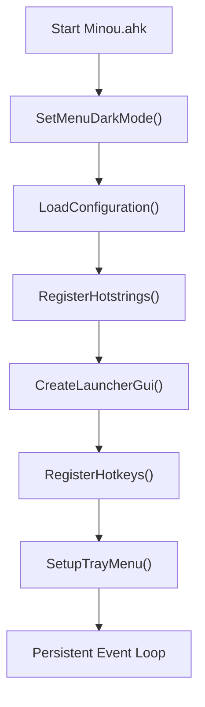

# Architecture

Minou is a modern, modular, dark-themed popup launcher and automation suite built for AutoHotkey v2.0 on Windows 11. It bridges keyboard-driven rapid command execution with mouse-friendly contextual menus.

> **See also:**
> - [02-Configuration.md](02-Configuration.md) — JSON schema details for all `Config/` files
> - [03-Api-And-Helpers.md](03-Api-And-Helpers.md) — Full function and class reference
> - [04-Roadmap.md](04-Roadmap.md) — Planned modules and future milestones

---

## 1. Architectural Evolution

Minou's codebase reflects a deliberate transition from a monolithic script prototype to a clean modular system:

```
Legacy Prototype (Minou AHK)               Modular System (Minou.ahk)
┌───────────────────────────────┐          ┌───────────────────────────────┐
│ 789-line monolithic script    │          │ Minou.ahk (Root Orchestrator) │
│ - Built-in AHK Menu() popups  │   ───►   ├─ Modules/Json.ahk        ✅   │
│ - Embedded JSON parser        │          ├─ Modules/MenuBuilder.ahk  ✅   │
│ - Mixed logic & data bindings │          ├─ Modules/Launcher.ahk     ✅   │
│ - Single config.json          │          ├─ Modules/Hotstrings.ahk   ✅   │
└───────────────────────────────┘          └─ Modules/* (Stubs)        🔲   │
                                           └─ Config/*.json (6 files)      ┘
```

### Why Replace Native `Menu()` with a Custom GUI?

The initial implementation used AHK's native `Menu()` object styled via `uxtheme.dll`. The project transitioned to a custom GUI (`Modules/Launcher.ahk`) for several architectural advantages:

| Limitation of Native `Menu()` | Custom GUI Solution |
| :--- | :--- |
| Cannot host an interactive Edit control | Search box (`Edit`) at top of window |
| OS-controlled dark theme — partial only | Full hex color control: `0x1A1A1A`, `0x232323` |
| No multi-column display | Two-column `ListView` (Name + Category) |
| No live filtering | Real-time `RefreshLauncherResults()` on every keystroke |
| Cannot show running AHK scripts | `WinGetList("ahk_class AutoHotkey")` scan |
| Keyboard navigation limited to OS defaults | `#HotIf IsLauncherActive()` scoped `Up`/`Down`/`Enter` |

---

## 2. Directory Layout & Module Responsibilities

```
Minou/
├── Minou.ahk                       # ✅ Root entry point & lifecycle coordinator
├── Minou AHK                       # Legacy monolithic reference script (789 lines)
├── AGENTS.md                       # Root authority for AI agents (coding rules, ACIP)
├── Instructions 2 Minou F3 PCPaths.md  # Original master design specification
│
├── Config/                         # Modular JSON configuration (see 02-Configuration.md)
│   ├── config.json                 # Core programs, folders, utilities
│   ├── settings.json               # Hotkeys and visual settings
│   ├── urls.json                   # Categorized web bookmarks and cyber tools
│   ├── snippets.json               # Dynamic text snippets & templates
│   ├── prompts.json                # LLM system prompts & templates
│   ├── utilities.json              # Categorized and subcategorized utilities
│   └── hotstrings.json             # Auto-expansion hotstrings definitions
│
├── Modules/                        # Feature modules
│   ├── Json.ahk          ✅        # OOP JSON parser & serializer (JsonParser, StringifyJson)
│   ├── MenuBuilder.ahk   ✅        # Aggregates all data sources into unified entry records
│   ├── Launcher.ahk      ✅        # Custom dark Fluent GUI & keyboard event handlers
│   ├── Hotstrings.ahk    ✅        # Text expansion manager and GUI editor
│   ├── Utilities.ahk     ✅        # Native encoders, formatters, and sysadmin diagnostics
│   ├── Icons.ahk         🔲        # (Planned) Local icon extraction & shell caching
│   ├── Search.ahk        🔲        # (Planned) Fuzzy search engine across all item types
│   ├── Settings.ahk      🔲        # (Planned) Runtime configuration & hotkey manager
│   ├── WindowManager.ahk 🔲        # (Planned) Multi-monitor placement & window activation
│   ├── Snippets.ahk      🔲        # (Planned) Advanced template & token substitution engine
│   └── Prompts.ahk       🔲        # (Planned) Markdown prompt loader and clipboard injector
│
├── Cache/                          # Runtime persistent cache
│   ├── icons.db                    # Cached icon paths / binaries (future: Icons.ahk)
│   └── recent.json                 # Usage tracking and recents history
│
├── Plugins/                        # Drop-in third-party extension modules (future)
│
├── Assets/                         # Static resources
│   └── Icons/                      # Bundled SVG / PNG assets
│
└── Docs/                           # Canonical project documentation
    ├── 01-Architecture.md          # ← This file
    ├── 02-Configuration.md         # JSON schema reference
    ├── 03-Api-And-Helpers.md       # Function & class API reference
    ├── 04-Roadmap.md               # Development milestones
    ├── 05_ChangeLog.md             # Version history
    ├── 06_DocumentationIndex.md    # Master cross-reference index
    └── AGENTS.md                   # Documentation-level AI agent rules
```

> **Legend:** ✅ Implemented · 🔲 Planned stub (empty file, reserved for future milestone)

---

## 3. Initialization Lifecycle (`InitMinou`)

When `Minou.ahk` launches, initialization follows a strictly deterministic boot sequence. All state is loaded into memory before any hotkey is active.



### Step-by-Step Breakdown

#### 1. `SetMenuDarkMode()`
Calls `uxtheme.dll` via `DllCall` using **ordinal numbers** (not exported names — these are undocumented):

```ahk
uxtheme := DllCall("GetModuleHandle", "str", "uxtheme", "ptr")
SetPreferredAppMode := DllCall("GetProcAddress", "ptr", uxtheme, "ptr", 135, "ptr")
DllCall(SetPreferredAppMode, "int", 2)   ; 2 = ForceDark
FlushMenuThemes := DllCall("GetProcAddress", "ptr", uxtheme, "ptr", 136, "ptr")
DllCall(FlushMenuThemes)
```

- Ordinal **135** = `SetPreferredAppMode` — accepts `0` (default), `1` (AllowDark), `2` (ForceDark), `3` (ForceLight)
- Ordinal **136** = `FlushMenuThemes` — invalidates cached menu theme data to apply change immediately
- Entire block wrapped in `try/catch` — silently ignored on unsupported Windows builds

#### 2. `LoadConfiguration()`
Reads all six config files from `Config/` into their corresponding global `Map` or `Array` variables using `LoadJsonFile()` from `Modules/Json.ahk`. Also:
- Calls `RegisterHotstrings()` immediately after loading `HotstringData` to activate auto-expansions
- Guards against missing keys with `Has()` checks; initializes empty arrays if absent
- Extracts `ProgramData`, `FolderData`, `UtilityData` as direct references from `ConfigData`

Config file → global variable mapping:

| File | Global Variable | Type |
| :--- | :--- | :--- |
| `Config/config.json` | `ConfigData` | `Map` |
| `Config/settings.json` | `SettingsData` | `Map` |
| `Config/urls.json` | `UrlData` | `Map` |
| `Config/snippets.json` | `SnippetData` | `Map` |
| `Config/prompts.json` | `PromptData` | `Array` |
| `Config/hotstrings.json` | `HotstringData` | `Array` |

> For full schema details, see [02-Configuration.md](02-Configuration.md).

#### 3. `CreateLauncherGui()`
Constructs the borderless, always-on-top Fluent GUI in `Modules/Launcher.ahk`. Window is built once and hidden — `Hide()`/`Show()` is used thereafter, never `Destroy()`/recreate. See [§ 5. GUI Layout](#5-gui-layout--window-positioning) for exact control coordinates.

#### 4. `RegisterHotkeys()`
Reads `SettingsData["hotkey"]` and `SettingsData["searchHotkey"]` with fallback defaults:
```ahk
hotkeyMain   := SettingsData.Has("hotkey")       ? SettingsData["hotkey"]       : "F3"
hotkeySearch := SettingsData.Has("searchHotkey") ? SettingsData["searchHotkey"] : "+F3"
Hotkey(hotkeyMain,   (*) => ShowLauncherGui(false))
Hotkey(hotkeySearch, (*) => ShowLauncherGui(true))
```

#### 5. `SetupTrayMenu()`
Completely replaces the default AHK tray menu:

| Menu Item | Action |
| :--- | :--- |
| Show Minou (F3) | `ShowLauncherGui(false)` |
| Search Mode (Shift+F3) | `ShowLauncherGui(true)` |
| Hotstring Manager | `ShowHotstringManager()` |
| *(separator)* | — |
| Edit config | `Run("notepad.exe " . ConfigFile)` |
| Reload | `Reload()` |
| Exit | `ExitApp()` |

---

## 4. Module Dependency Graph

```
Minou.ahk
    │
    ├── #Include Modules\Json.ahk          (no dependencies — pure AHK)
    │       ├── ParseJson()
    │       ├── StringifyJson()
    │       ├── LoadJsonFile()             ← used by LoadConfiguration()
    │       └── SaveJsonFile()             ← used by SaveAllHotstrings()
    │
    ├── #Include Modules\MenuBuilder.ahk   (depends on: Minou.ahk globals, Json.ahk)
    │       └── BuildMenuEntries()         ← called by RefreshLauncherData()
    │
    ├── #Include Modules\Launcher.ahk      (depends on: MenuBuilder.ahk, Minou.ahk globals)
    │       ├── CreateLauncherGui()        ← called by InitMinou
    │       ├── ShowLauncherGui()          ← called by hotkeys & tray
    │       ├── RefreshLauncherData()      ← calls BuildMenuEntries()
    │       ├── RefreshLauncherResults()   ← called on every keypress
    │       ├── RunSelectedEntry()         ← calls LaunchItem()
    │       └── IsLauncherActive()         ← used by #HotIf
    │
    └── #Include Modules\Hotstrings.ahk   (depends on: Json.ahk globals)
            ├── ShowHotstringManager()     ← called by tray
            ├── ApplyHotstrings()          ← called at boot & save
            └── SaveAllHotstrings()        ← calls SaveJsonFile()
```

**Include order is significant:** `Json.ahk` must be first since `LoadJsonFile` and `SaveJsonFile` are called by functions in every other module.

---

## 5. Global State & Data Pipeline

To achieve instant popup response times (< 16 ms), Minou holds all parsed data in memory. No file I/O occurs when a hotkey fires.

### Complete Global Variable Table

| Variable | Type | Source | Populated By | Purpose |
| :--- | :--- | :--- | :--- | :--- |
| `ScriptTitle` | `String` | Hard-coded | Startup | Tray tooltip text |
| `BaseDir` | `String` | `A_ScriptDir` | Startup | Root path |
| `ConfigDir` | `String` | `BaseDir . "\Config"` | Startup | Config folder path |
| `ConfigFile` | `String` | path | Startup | Full path to `config.json` |
| `SettingsFile` | `String` | path | Startup | Full path to `settings.json` |
| `UrlsFile` | `String` | path | Startup | Full path to `urls.json` |
| `SnippetsFile` | `String` | path | Startup | Full path to `snippets.json` |
| `PromptsFile` | `String` | path | Startup | Full path to `prompts.json` |
| `HotstringFile` | `String` | path | Startup | Full path to `hotstrings.json` |
| `ConfigData` | `Map` | `Config/config.json` | `LoadConfiguration()` | Programs, folders, utilities |
| `SettingsData` | `Map` | `Config/settings.json` | `LoadConfiguration()` | Hotkeys, theme |
| `UrlData` | `Map` | `Config/urls.json` | `LoadConfiguration()` | Categorized bookmarks |
| `SnippetData` | `Map` | `Config/snippets.json` | `LoadConfiguration()` | Text templates |
| `PromptData` | `Array` | `Config/prompts.json` | `LoadConfiguration()` | LLM prompts |
| `HotstringData` | `Array` | `Config/hotstrings.json` | `LoadConfiguration()` | Auto-expansion rules |
| `ProgramData` | `Array` | `ConfigData["programs"]` | `LoadConfiguration()` | Program entries |
| `FolderData` | `Array` | `ConfigData["folders"]` | `LoadConfiguration()` | Folder entries |
| `UtilityData` | `Array` | `ConfigData["utilities"]` | `LoadConfiguration()` | Utility commands |
| `AllSearchItems` | `Array` | Copy of `CurrentEntries` | `RefreshLauncherData()` | Full search catalogue |
| `LauncherGui` | `Gui Obj` | Built | `CreateLauncherGui()` | Main GUI window |
| `SearchBox` | `Control Obj` | Built | `CreateLauncherGui()` | Search Edit control |
| `CategoryListBox` | `Control Obj` | Built | `CreateLauncherGui()` | Category filter ListBox |
| `ResultsListView` | `Control Obj` | Built | `CreateLauncherGui()` | Results ListView |
| `CurrentEntries` | `Array` | `BuildMenuEntries()` | `RefreshLauncherData()` | All normalized entries |
| `CurrentCategory` | `String` | `"All"` | `OnCategoryChange()` | Active category filter |
| `VisibleEntries` | `Array` | Filter of `CurrentEntries` | `RefreshLauncherResults()` | Currently shown entries |
| `IsRefreshingLauncher` | `Boolean` | `false` | `RefreshLauncherResults()` | Re-entry guard |
| `HotstringGui` | `Gui Obj / ""` | Built on demand | `ShowHotstringManager()` | Hotstring manager window |
| `HotstringListView` | `Control Obj / ""` | Built on demand | `ShowHotstringManager()` | Hotstring ListView |
| `RegisteredHotstrings` | `Array` | `ApplyHotstrings()` | `ApplyHotstrings()` | Tracks live trigger list |

### Data Flow: Config → GUI

```
Config/*.json
    │
    ▼ LoadJsonFile() [Json.ahk]
    │
Global Maps/Arrays (in memory)
    │
    ▼ BuildMenuEntries() [MenuBuilder.ahk]
    │
CurrentEntries: Array of unified { name, category, kind, target, hwnd? }
    │
    ▼ RefreshLauncherResults() [Launcher.ahk]
    │
VisibleEntries (filtered subset) → ResultsListView rows
    │
    ▼ RunSelectedEntry() → LaunchItem() [Minou.ahk]
    │
SafeRun() / PasteText() / WinActivate() / A_Clipboard
```

### Unified Item Structure

Every launchable item across all sources is normalized by `BuildMenuEntries()` into a uniform object:

```ahk
{
    name:     "Entry Display Name",
    category: "Category Name",
    kind:     "url" | "program" | "folder" | "snippet" | "prompt" | "utility" | "setting" | "script",
    target:   "Path / URL / Text Payload / Command",
    hwnd:     0x12345  ; Optional — only present for kind = "script"
}
```

**`kind` values and their dispatch:**

| `kind` | Source | `LaunchItem()` action |
| :--- | :--- | :--- |
| `"url"` | `UrlData` | `SafeRun(target)` |
| `"program"` | `ProgramData` | `FileExist()` check + `SafeRun()` |
| `"folder"` | `FolderData` | `SafeRun("explorer.exe", target)` |
| `"snippet"` | `SnippetData` | `PasteText(target)` |
| `"prompt"` | `PromptData` | `A_Clipboard := target` + tooltip |
| `"utility"` | `UtilityData` | `SafeRun(target)` |
| `"setting"` | Hardcoded | `SafeRun("ms-settings:...")` |
| `"script"` | Live AHK windows | `WinActivate("ahk_id " . hwnd)` |

---

## 6. GUI Layout & Window Positioning

The launcher GUI is a **580 × 390 px** borderless, always-on-top Fluent window. Controls are positioned with fixed coordinates:

```
┌─────────────────────────────────────────────────────────────┐  ← y=0
│ Minou Launcher                                              │  ← Text x12 y10
│ ┌───────────────────────────────────────────────────────┐   │  ← Edit x12 y34 w560 h28
│ │ Search...                                             │   │    Background 0x232323
│ └───────────────────────────────────────────────────────┘   │
│ ┌──────────────────┐ ┌───────────────────────────────────┐  │  ← y=72
│ │ All              │ │ Name              │ Category       │  │
│ │ Programs         │ │ VS Code           │ Programs       │  │
│ │ Folders          │ │ Windows Terminal  │ Programs       │  │
│ │ Cybersecurity    │ │ VirusTotal        │ Cybersecurity  │  │
│ │ Prompts          │ │ Debug Code        │ Prompts        │  │
│ │ Snippets         │ │ Email Signature   │ Text           │  │
│ │ Utilities        │ │ Calculator        │ Utilities      │  │
│ │ Windows Settings │ │ Display           │ Windows Sett.. │  │
│ │ Running Scripts  │ │ ...               │ ...            │  │
│ └──────────────────┘ └───────────────────────────────────┘  │  ← y=352
│ ← w170             → ← w382, x190                       →   │
│ F3 launch • Shift+F3 search • Enter run • Esc close [Hstr]  │  ← y=355-360
└─────────────────────────────────────────────────────────────┘  ← y=390
← x=0                                                    x=580 →
```

**Control specifications:**

| Control | Type | Position | Size | Style |
| :--- | :--- | :--- | :--- | :--- |
| Title label | `Text` | x12 y10 | w560 | `cC0C0C0` |
| Search box | `Edit` | x12 y34 | w560 h28 | `Background0x232323 cWhite` |
| Category filter | `ListBox` | x12 y72 | w170 h280 | `Background0x232323 cWhite` |
| Results | `ListView` | x190 y72 | w382 h280 | `Background0x232323 cWhite Grid` |
| Footer hint | `Text` | x12 y360 | w560 | `c808080` |
| Hotstrings button | `Button` | x480 y355 | w90 h24 | — |

**Column widths in ResultsListView:**
- Column 1 "Name": 220 px
- Column 2 "Category": 140 px

### Positioning Algorithm

```ahk
MouseGetPos(&mouseX, &mouseY)
xPos := mouseX + 20                              ; 20px right of cursor
yPos := mouseY + 20                              ; 20px below cursor
if (xPos + 600 > A_ScreenWidth)                  ; prevent clipping right edge
    xPos := A_ScreenWidth - 620
if (yPos + 400 > A_ScreenHeight)                 ; prevent clipping bottom edge
    yPos := A_ScreenHeight - 420
LauncherGui.Show("x" . xPos . " y" . yPos . " w580 h390")
```

### Focus Handling

| Trigger | `searchMode` | Behavior |
| :--- | :--- | :--- |
| `F3` | `false` | Show at cursor, refresh results, keep last search |
| `Shift+F3` | `true` | Show at cursor, clear search box, focus search box |
| Tray → Show | `false` | Same as `F3` |

### Context-Sensitive Keyboard Navigation

Navigation keys are only active when the launcher window has focus, using `#HotIf`:

```ahk
#HotIf IsLauncherActive()
Up::MoveSelection(-1)
Down::MoveSelection(1)
Enter::RunSelectedEntry()
#HotIf
```

`IsLauncherActive()` returns `LauncherGui != "" && WinActive("ahk_id " . LauncherGui.Hwnd)`.

---

## 7. Execution & Security Isolation (`SafeRun`)

Launching programs on modern Windows systems can encounter WDAC (Windows Defender Application Control) or AppLocker blocks when executed via standard AutoHotkey `Run()`.

### Current Implementation

`SafeRun(target, args := "")` in `Minou.ahk` currently dispatches via branching logic:

```ahk
SafeRun(target, args := "") {
    target := ExpandEnvVars(target)              ; Step 1: resolve env vars
    if (target = "")
        return
    try {
        if (InStr(target, "http://") || InStr(target, "https://")
            || InStr(target, "ms-settings:") || InStr(target, "shell:"))
            Run(target)                          ; Protocol URIs → direct Run
        else if (FileExist(target))
            Run(target)                          ; File exists → direct Run
        else
            Run(target . (args != "" ? " " . args : ""))   ; Fallback
    } catch {
        ToolTip("Could not launch target.")
        SetTimer((*) => ToolTip(), -1500)        ; Auto-clear tooltip
    }
}
```

### Planned WDAC Bypass (Architecture Target)

The planned upgrade replaces `Run()` with COM delegation:

```ahk
ComObject("Shell.Application").ShellExecute(expandedTarget, strArgs, "", "open", 1)
```

This delegates process creation directly to `explorer.exe`, bypassing AHK's `RunWithHandles` WDAC block. If COM instantiation fails, falls back to native `Run()`, displaying a non-blocking tooltip error.

> For `ExpandEnvVars()` details and all supported tokens, see [03-Api-And-Helpers.md § ExpandEnvVars](03-Api-And-Helpers.md).

---

## 8. Running AHK Script Detection

`BuildMenuEntries()` in `MenuBuilder.ahk` dynamically detects all running AutoHotkey scripts at launcher-show time:

```ahk
DetectHiddenWindows(true)
for hwnd in WinGetList("ahk_class AutoHotkey") {
    if (hwnd != A_ScriptHwnd) {               ; Exclude Minou itself
        title := WinGetTitle("ahk_id " . hwnd)
        if (title != "")
            entries.Push({ name: title, category: "Running Scripts", kind: "script", hwnd: hwnd })
    }
}
```

When a "Running Scripts" entry is selected and launched, `LaunchItem()` calls `WinActivate("ahk_id " . entry.hwnd)`, bringing the script's window to the foreground.

> For planned IPC controls (Reload, Suspend, Kill), see [04-Roadmap.md](04-Roadmap.md).

---

## 9. Hotstring System Architecture

`Modules/Hotstrings.ahk` manages a complete lifecycle for auto-expansion text triggers:

```
HotstringData (Array in memory)
    │
    ├─ At boot:     RegisterHotstrings() → ApplyHotstrings()
    ├─ GUI editor:  ShowHotstringManager()
    │                   ├─ Add/Edit/Delete rows in ListView
    │                   └─ SaveAllHotstrings()
    │                           ├─ Rebuild HotstringData from ListView state
    │                           ├─ SaveJsonFile(HotstringFile, HotstringData)
    │                           └─ ApplyHotstrings()
    │
    └─ ApplyHotstrings()
            ├─ Disable all previously registered triggers
            └─ Register active triggers via Hotstring("::" . trigger, replacement)
```

The `RegisteredHotstrings` array tracks all currently active trigger strings so they can be cleanly disabled before re-registration, preventing duplicate or ghost hotstrings.

---

## 10. Design Constraints & Performance Rules

These constraints are enforced by [AGENTS.md](../AGENTS.md) and must never be violated:

| Constraint | Rationale |
| :--- | :--- |
| All config read at startup, never on hotkey | Ensures < 16 ms response time |
| `Json.ahk` included first | Other modules call `LoadJsonFile` / `SaveJsonFile` |
| GUI is built once, reused via `Hide()`/`Show()` | Avoids control recreation overhead |
| `VisibleEntries` not `CurrentEntries` for row lookup | Filtered row indices must map to filtered data |
| `IsRefreshingLauncher` guard in `RefreshLauncherResults` | Prevents re-entrant UI updates |
| All launches through `SafeRun()` | WDAC compliance, error isolation |
| `global` declared in every function touching globals | AHK v2 assume-local scope discipline |
